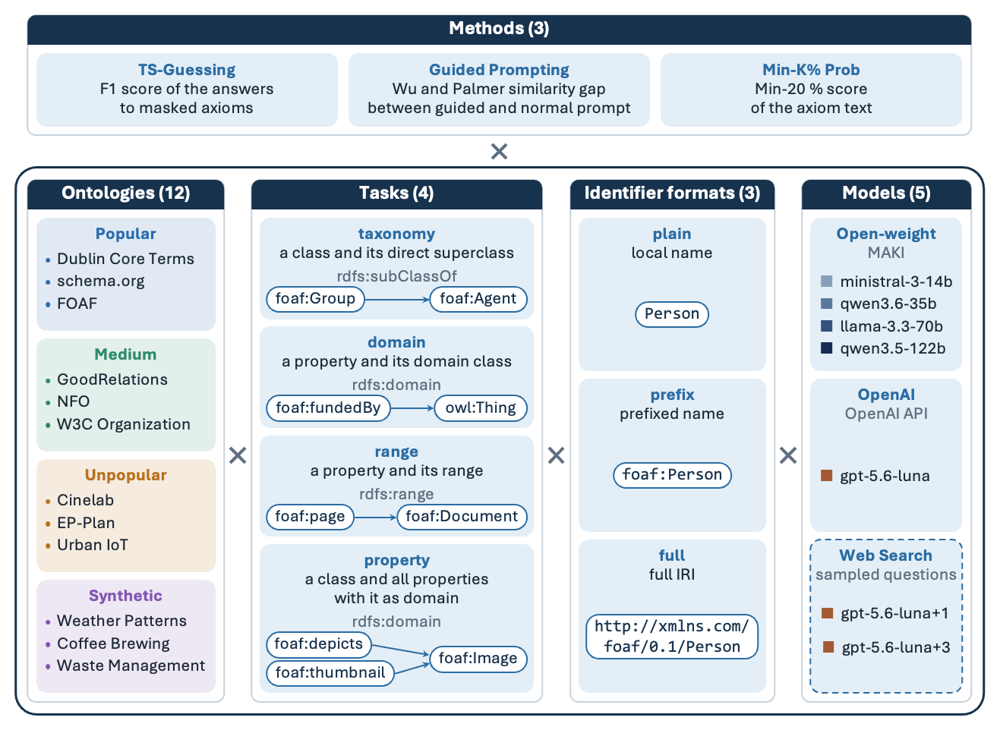
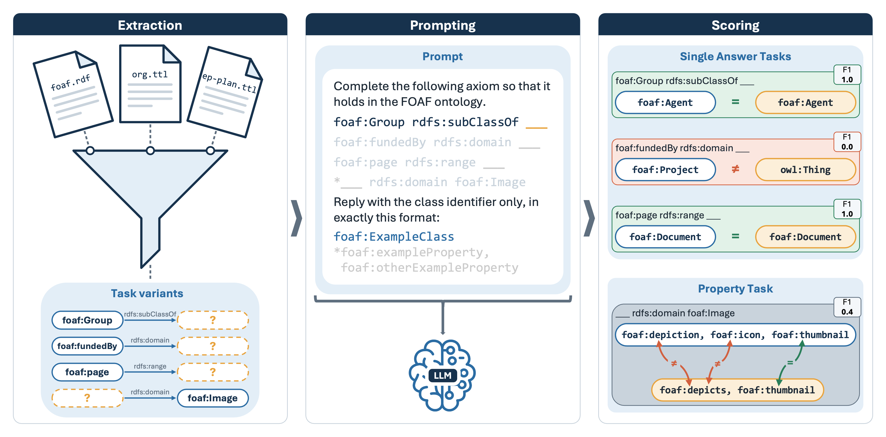
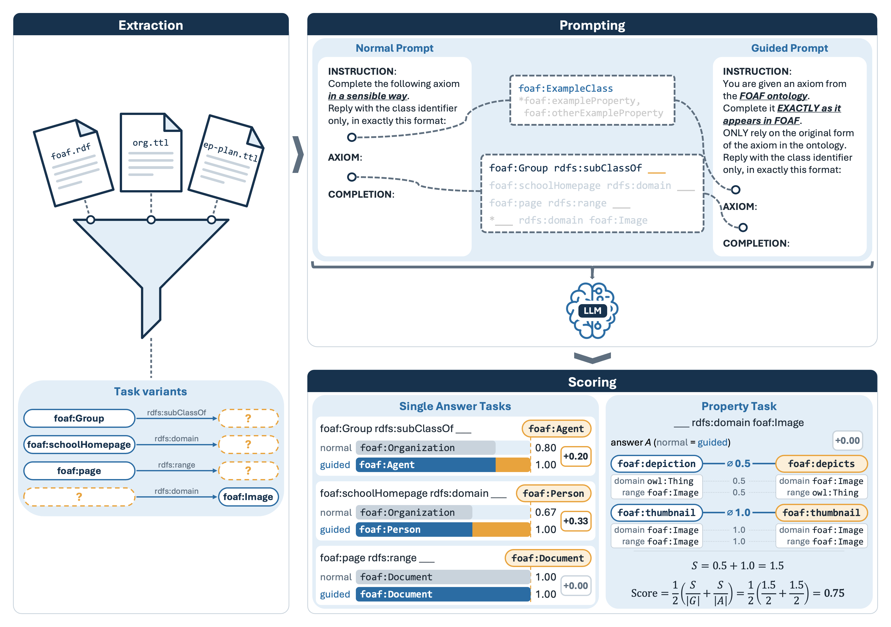
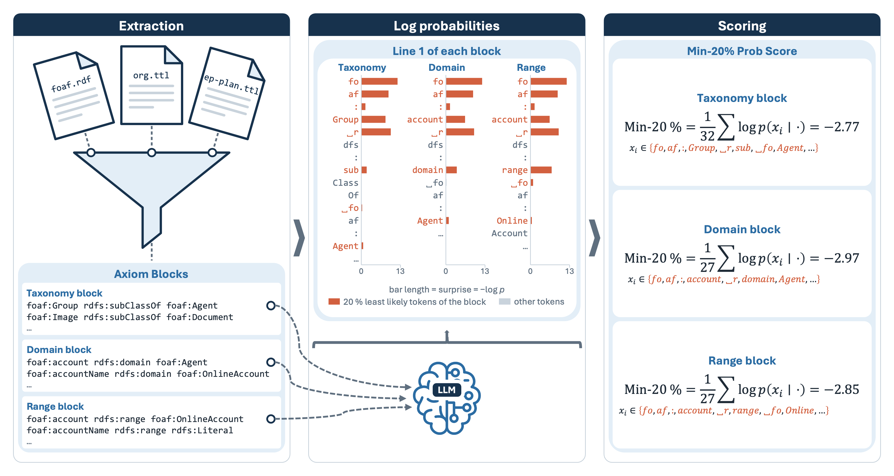

# How Much Do Current LLMs Know About Public Ontologies?

[Project page](https://7danielp.github.io/llm-ontology-leakage/)

## Abstract

Large language models (LLMs) have made rapid advances, which have led to remarkable performance on several benchmarks. This progress has made them very promising for ontology tasks too, such as constructing, refining and matching ontologies. Their performance in this area, however, is mostly evaluated on benchmarks of public ontologies. This has raised concerns about whether these evaluations are reliable, as the models are often trained on public data and may have seen these ontologies before, a problem known as data leakage. Data leakage inflates the measured performance, making the evaluations less meaningful. This matters particularly in such a complex area, where generalization ability is essential. Many methods for detecting data leakage have already been proposed, yet they have not been applied to ontologies systematically. Against this background, this thesis addresses the question of how much current LLMs know about public ontologies. To explore this open question, three data leakage detection methods, each with a different approach, are applied with five LLMs to several axiom types of nine public ontologies of varying popularity. Three synthetically generated ontologies serve as an unseen baseline. The objective is to gain insights into whether the methods arrive at the same conclusion and how ontology popularity, axiom type, identifier format, model size and web search influence their results. Throughout, the experiments show similar results. Under all three methods the models seem most familiar with popular ontologies, and with decreasing popularity the scores fall, down to about the level of the synthetic baseline. These results consistently point to data leakage, mainly in widely used ontologies. They therefore give legitimate reason for concern that current evaluations may be affected by data leakage, and moreover call for deeper investigation of this topic and of alternative evaluation approaches.

## Methods

### Experiment overview



The three data leakage detection methods are applied to twelve ontologies, three each in a popular, a medium, an unpopular and a synthetic tier, in four tasks (taxonomy, domain, range, property) and three identifier formats (plain `Person`, prefix `foaf:Person`, full IRI `http://xmlns.com/foaf/0.1/Person`) with five models. With web search, gpt-5.6-luna answers a sample of the questions again, with at most one and with up to three tool calls per answer. The figure shows FOAF in the prefix format as an example.

### TS-Guessing



Based on Deng et al. (2024). The taxonomy, domain and range axioms of the ontologies are extracted into the four tasks, and each question is sent to the model as a prompt. Grey text shows the prompt of the other tasks, and the asterisk marks the property task, which asks for a comma-separated list. The answers are scored with the F1 score.

### Guided Prompting



Based on Golchin and Surdeanu (2024). Every masked axiom is sent in a normal prompt and in a guided prompt, which names the ontology and asks for the original form. The gap is the guided minus the normal Wu and Palmer similarity (Meng, Huang and Gu 2013) to the gold. In the property task, the Jonker-Volgenant algorithm (Jonker and Volgenant 1987) pairs answer and gold properties by their mean domain and range similarity.

### Min-K% Prob



Based on Shi et al. (2024). The axioms of one task are stacked into blocks of ten lines, and in echo mode the model returns the log probability of every token. The mean over the least likely 20 % of tokens is the Min-20 % score of a block, and the score of an ontology averages all its blocks. The OpenAI API returns no log probabilities for the input, so this method runs on the four MAKI models only.

### References

- Deng, Chunyuan, Yilun Zhao, Xiangru Tang, Mark Gerstein and Arman Cohan. 2024. Investigating Data Contamination in Modern Benchmarks for Large Language Models. In *Proceedings of the 2024 Conference of the North American Chapter of the Association for Computational Linguistics: Human Language Technologies (Volume 1: Long Papers)*, pp. 8706-8719. Mexico City, Mexico. Association for Computational Linguistics. https://doi.org/10.18653/v1/2024.naacl-long.482
- Golchin, Shahriar and Mihai Surdeanu. 2024. Time Travel in LLMs: Tracing Data Contamination in Large Language Models. In *The Twelfth International Conference on Learning Representations (ICLR 2024)*. https://openreview.net/forum?id=2Rwq6c3tvr
- Jonker, R. and A. Volgenant. 1987. A Shortest Augmenting Path Algorithm for Dense and Sparse Linear Assignment Problems. *Computing* 38 (4), pp. 325-340. https://doi.org/10.1007/BF02278710
- Meng, Lingling, Runqing Huang and Junzhong Gu. 2013. A Review of Semantic Similarity Measures in WordNet. *International Journal of Hybrid Information Technology* 6 (1), pp. 1-12. https://gvpress.com/journals/IJHIT/vol6_no1/1.pdf
- Paulheim, Heiko. 2025. Ontologies, Knowledge Graphs, and LLMs: How Do We GET Evaluations Done Right? In *ISWC 2025 Companion Volume*, CEUR Workshop Proceedings 4085, pp. 320-325. Nara, Japan. https://ceur-ws.org/Vol-4085/paper53.pdf
- Shi, Weijia, Anirudh Ajith, Mengzhou Xia, Yangsibo Huang, Daogao Liu, Terra Blevins, Danqi Chen and Luke Zettlemoyer. 2024. Detecting Pretraining Data from Large Language Models. In *The Twelfth International Conference on Learning Representations (ICLR 2024)*. https://openreview.net/forum?id=zWqr3MQuNs

## Repository structure

```
main.py                      command line with run, grid and aggregate
generate_synthetic.py        generation of a synthetic ontology (GET method, Paulheim 2025)
extract_sample.py            cuts the sampled questions out of the full runs, as the reference without web search
llm_ontology_leakage/        main code
  core/                      ontology presets and run settings, ontology loading and question extraction,
                             answer parsing, API clients, run folders, task definitions, table helpers
  ts_guessing/               runner, scoring and tables of TS-Guessing
  guided_prompting/          runner, similarity measures and tables of Guided Prompting
  min_k/                     runner and tables of Min-K% Prob
ressources/
  ontologies/                the twelve ontology files, ONTOLOGIES.md (sources, LOV counts, download dates)
                             and lov_query.csv (result of the LOV query)
  figures/                   the figures of the thesis (PDF and PNG) and the three method diagrams
results/
  full-no-web-search/        every run of the three methods in runs/<method>/ and the tables built from them
                             (CSV and LaTeX)
  sampled-web-search-1call/  gpt-5.6-luna on 10 sampled questions per task with at most one web tool call
                             (runs/<method>/sample-web/) and the same questions from the full runs (sample-reference/)
  sampled-web-search-3calls/ the same with up to three web tool calls
analysis/                    scripts for the tables, figures and other checks of the thesis
docs/                        project page with the command builder and the web search sources
pyproject.toml, uv.lock      dependencies
.env.example                 template for the API keys
```

A run folder is named `<TS|GP|MK>__<ontology>__<task>__<model>__<format>`. Its `records.jsonl` holds one line per question (one per block for Min-K% Prob) with the prompt, the model output and the score, `run_meta.json` the settings of the run and `summary.json` its result.

## Running

Python 3.13 and [uv](https://docs.astral.sh/uv/) are required.

```
git clone https://github.com/7danielp/llm-ontology-leakage.git
cd llm-ontology-leakage
uv sync
```

The API keys go into a `.env` file in the repository root, which git ignores. Copy the template and fill it in.

```
cp .env.example .env
```

| Variable | Needed for |
|---|---|
| `MAKI_BASE_URL`, `MAKI_API_KEY` | the four open-weight models, served by the MAKI inference API of the University of Mannheim |
| `OPENAI_API_KEY` | gpt-5.6-luna |

The command builder on the [project page](https://7danielp.github.io/llm-ontology-leakage/) composes the commands. The most important ones are these.

```
# one run (one method, ontology, task, model and identifier format)
uv run main.py run --method ts-guessing --ontology-preset FOAF --task domain --model llama-3.3-70b --format prefix

# every task, model and format of one method on one ontology (--tasks, --models and --formats narrow it down)
uv run main.py grid --method guided-prompting --ontology-preset FOAF

# rebuild the tables from the stored runs, without any API call
uv run main.py aggregate --method ts-guessing
```

Runs and tables go to `results/full-no-web-search` unless `--results-dir` names another folder.

| Option | Values |
|---|---|
| `--method` | `ts-guessing`, `guided-prompting`, `min-k` |
| `--ontology-preset` | `FOAF`, `SCHEMA`, `DCTERMS`, `GOODRELATIONS`, `NFO`, `ORG`, `CINELAB`, `EPPLAN`, `URBANIOT`, `SYNTH-1` (Weather Patterns), `SYNTH-2` (Coffee Brewing), `SYNTH-3` (Waste Management) |
| `--task` | `taxonomy`, `domain`, `range`, `property` (Min-K% Prob has no property task) |
| `--model` | `qwen3.5-122b`, `llama-3.3-70b`, `qwen3.6-36b`, `ministral-3-14b` (MAKI) and `gpt-5.6-luna` (OpenAI); `qwen3.6-36b` is the MAKI name of the model called qwen3.6-35b in the thesis |
| `--format` | `plain`, `prefix`, `full` |

`--limit N` runs only the first N questions, and `--mock` answers with canned text, so the pipeline can be tested without any API key.

```
uv run main.py run --method guided-prompting --ontology-preset FOAF --task domain --model mock --format prefix --mock --limit 2 --results-dir /tmp/smoke
```

The web search runs append `+web` (at most one tool call) or `+web3` (up to three) to the model name and ask 10 sampled questions per task. `extract_sample.py` then cuts the same questions out of the full runs as the reference without web search.

```
uv run main.py grid --method ts-guessing --ontology-preset FOAF --models gpt-5.6-luna+web --sample 10 --results-dir results/sampled-web-search-1call
uv run extract_sample.py --results-dir results/sampled-web-search-1call
uv run main.py aggregate --method ts-guessing --results-dir results/sampled-web-search-1call
```

Ontologies (`ONTOLOGY_PRESETS`) and models (`OPENAI_MODELS`, `GRID_MODELS`) are configured in `llm_ontology_leakage/core/config.py`.

## License

The code is released under the MIT license (see `LICENSE`); the ontology files in `ressources/ontologies/` keep the licenses of their publishers.
